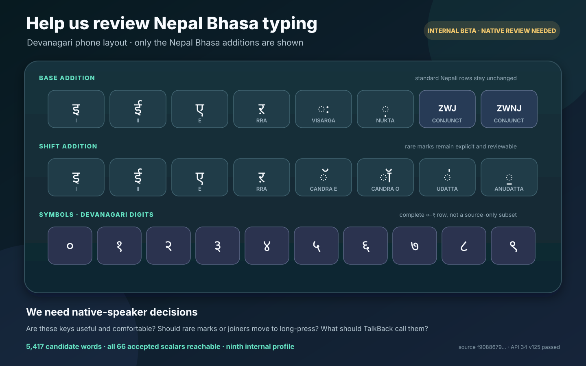

# Help us review Nepal Bhasa typing in Devanagari

We now have a working internal Android beta for Nepal Bhasa Devanagari: a
selectable language profile, a dedicated phone layout, and a 5,417-candidate
dictionary pack. We need native-speaker feedback before treating its layout or
suggestions as production quality.



**Share the [1440 × 900 PNG](nepal-bhasa-deva-layout-preview-v1.png), then use
the [review worksheet](#native-speaker-review-worksheet).** The
[SVG source](nepal-bhasa-deva-layout-preview-v1.svg) is the authoritative
scalable image. The image shows only the Nepal Bhasa additions; the standard
Nepali phone rows remain underneath them in the keyboard.

## Ready-to-share introduction

> We are testing a Nepal Bhasa keyboard for Android and need help from people
> who type the language in Devanagari. The current internal beta has 5,417
> dictionary-backed candidate words and a dedicated layout that can type every
> character retained from that dictionary. The image shows the extra keys we
> added to the standard Nepali phone layout. Please tell us whether their
> placement is natural, which rare marks should move to long-press, what
> TalkBack should call each key, and which common words or spellings are
> missing. The software works in our API 34 emulator tests; this review is about
> whether it works well for Nepal Bhasa users.

The selectable internal layout adds:

- a base row for `इ`, `ई`, `ए`, `ऱ`, `ः`, `़`, ZWJ, and ZWNJ;
- a Shift row for `इ`, `ई`, `ए`, `ऱ`, `ॅ`, `ॉ`, `॑`, and `॒`;
- one complete Devanagari digit row, `०` through `९`, in symbols.

ZWJ and ZWNJ are closed conjunct keys: they work only after a Devanagari
virama and before a following Devanagari letter. The keyboard does not use them
to guess repairs for malformed or ambiguous dictionary forms.

## What has been checked

- The pinned 9,708-row source produced 9,647 accepted forms and 5,417 distinct
  candidate surfaces. Two independent source trees and NKP packs were byte-
  identical. The exact pack SHA-256 is
  `c353162185a7e9c2cf4b7de292d1359008605fbd908976fddc42cf2612c95803`.
- The accepted surfaces use 66 non-whitespace scalars. Layout
  `deva-nepal-bhasa-v1` emits all 66, and its source SHA-256 is
  `f9088679a904a8129e02b8202740564537e616d24b85637c1489038c35d93ac8`.
- The final v127 deterministic relock ran 232 focused tests and committed with
  every exit status at zero. The internal profile and layout lock hashes are
  `7aafd6a1b0a7eaf0af63ec4ca21a57afcab1bd29877d63287008e439a3df5292`
  and
  `d32af542f2d443b6f8a536c4a3e2667abc2a66d96696d39835083718d3af51a8`.
- A clean JDK 17 / Gradle 8.11.1 cdjk build assembled and linted the internal
  IME and benchmark APKs. All 9 build-evidence entries reverify.
- The detached v125 API 34 run loaded exactly nine selectable profiles and
  nine packs, passed the picker/layout/input-policy smoke, Decoder Contract v1,
  subtype and lifecycle checks, English/Nepali spatial correctness, the full
  nine-pack prefix benchmark, and all 17 corruption cases. All 101 runtime-
  evidence entries reverify.
- Nepal Bhasa completed 10,000 full-prefix measurements after 1,000 warmups.
  Its emulator-only full-suggestion P95 was 7.063 ms; no physical-phone latency
  claim is being made.

These checks prove deterministic artifacts and Android regression behavior.
They do not prove that the key placement is natural, suggestions are well
ranked, uncommon glyphs render on representative phones, or TalkBack names are
correct for native users.

The exact [layout source](../../layouts/internal/src/deva-nepal-bhasa-v1.json),
[candidate-pack policy](../../catalog/nepal-bhasa-candidate-pack-v0.json),
[pack report](../../reports/nepal-bhasa-candidate-pack-v0.md),
[Android milestone](../../reports/nepal-bhasa-internal-android-milestone-v0.md),
the [final deterministic relock evidence](../../reports/evidence/nepal-bhasa-community-handoff-v0/),
and [raw API 34 evidence](../../reports/evidence/nepal-bhasa-internal-android-v0/)
are available for inspection.

## What we need native speakers to decide

1. Is keeping the standard Nepali base layout the right starting point for
   Nepal Bhasa Devanagari typing?
2. Are `इ`, `ई`, `ए`, and `ऱ` useful enough to deserve visible row positions?
3. Should `ः` and nukta `़` remain visible on base, or move to Shift or
   long-press?
4. Should candra E `ॅ`, candra O `ॉ`, udatta `॑`, and anudatta `॒` be visible
   on Shift? Their dictionary evidence is sparse, so community judgment
   matters.
5. Should ZWJ and ZWNJ be visible keys, long-press choices after virama, or
   handled by an automatic conjunct workflow?
6. Is a complete `०–९` symbols row preferable to exposing only the digits
   observed inside dictionary headwords?
7. Seven source rows place joiners before a mark, digit, or malformed sequence
   and were excluded. Are any valid Nepal Bhasa spellings that need another
   input rule?
8. What should TalkBack speak for `ऱ`, the marks, ZWJ, and ZWNJ: Nepal Bhasa
   names, Nepali names, Unicode English names, or a bilingual form?
9. Which common words are missing, and which current first suggestions are
   wrong or unhelpfully ordered?

## Native-speaker review worksheet

Copy this template into an issue, forum message, or community discussion:

```text
I read/write Nepal Bhasa in Devanagari as:
Device and Android/browser version:

Standard Nepali rows: keep / changes:
Base addition row: approve / changes:
Shift addition row: approve / changes:
Devanagari digit row: approve / changes:
ZWJ and ZWNJ: visible / long-press / automatic / other:
Rare marks that should move or be removed:
Native spoken names for TalkBack:
Common words the dictionary suggestions are missing:
Examples where the first suggestion is wrong:
Other problems:
```

Screenshots of rendering problems are useful. Please include the device and
Android or browser version.

## Honest status

`new-Deva-NP` is the ninth selectable internal engineering profile and passed
the canonical API 34 emulator chain. It is still a beta: native review,
physical-device rendering and editing, accessibility review, typing-flow
review, and suggestion-quality evaluation remain open. Direct Newa-script,
romanized Nepal Bhasa, and Devanagari-to-Prachalit conversion are separate
methods and are not part of this direct-layout artifact.

Artifact identities:

- preview SVG: `ba319ebbbfee85af33047e47aa5c34b36aa9334364bc4407917d8f3588560bf2`;
- shareable PNG: `4e83431d8ef6d2e30e8b411e88631714bbc3626ad98d790b1624229c603c5ce2`;
- candidate pack: `c353162185a7e9c2cf4b7de292d1359008605fbd908976fddc42cf2612c95803`;
- layout source: `f9088679a904a8129e02b8202740564537e616d24b85637c1489038c35d93ac8`;
- v127 relock evidence manifest:
  `ea262fce7aee86452cff2cdc1a8fa6d3a14462815d06ebbfef012369d31a257f`;
- v125 API 34 evidence manifest:
  `45af5369add1295445210a006a43b06890dcab041ba4f832c7978885f43d67c5`.
