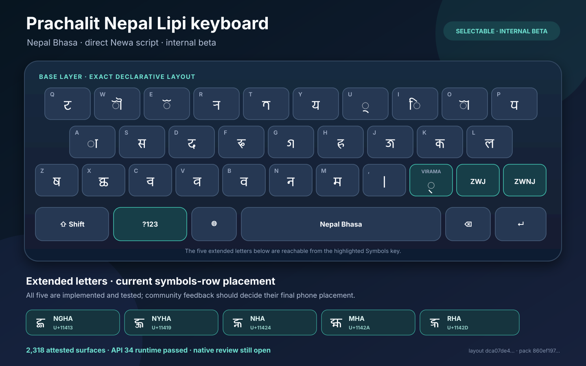

# Help us improve the Newa keyboard for Nepal Bhasa

We now have a non-default, selectable internal Android beta for direct
Newa/Prachalit Nepal Lipi typing. It is an engineering beta, not a finished or
public-release keyboard, and its native placement and accessibility review is
still open.



**Share the current [1440 × 900 PNG](newa-prachalit-internal-preview-v1.png),
then use the [native-speaker review worksheet](#native-speaker-review-worksheet).**
The current [SVG source](newa-prachalit-internal-preview-v1.svg) is the
authoritative scalable version. It shows the exact internal-beta base layer
and the five letters provisionally placed on its Symbols row.

## Ready-to-share introduction

> We are testing a direct Newa/Prachalit Nepal Lipi keyboard for Nepal Bhasa
> on Android and need feedback from people who read or write the language. A
> non-default internal beta can now be selected in our engineering builds. The
> image shows its inherited QWERTY-positioned base layer; the beta also puts
> NGHA, NYHA, NHA, MHA, and RHA on a provisional Symbols row. This is not a
> claim that the placement is correct. Please tell us whether the base, Shift,
> punctuation, conjunct controls, extended-letter row, suggestions, and
> TalkBack names are natural and usable.

The beta maps QWERTY key positions directly to Newa characters. It is not a
Latin-to-Newa transliterator. The selectable internal profile is
`new-Newa-NP`, bound to the
[internal beta layout](../../layouts/internal/src/newa-nepal-prachalit-v1.json)
and a deterministic 2,318-candidate Newa-script dictionary pack. It is not
default-enabled.

The exact [research layout](../../layouts/research/newa-nepal-qwerty-direct-v1.json),
[pending native-review packet](../../layouts/reviews/newa-nepal-qwerty-direct-v1.review.json),
and [technical rationale](../newa-qwerty-direct-candidate.md) remain available
for inspection. Internal selectability did not accept, rewrite, or supersede
that pending review packet.

The original [research SVG](newa-qwerty-direct-preview-v1.svg) and
[research PNG](newa-qwerty-direct-preview-v1.png) are retained unchanged as
historical artifacts. Their “research only · not selectable” label applies to
the pinned research candidate, not to the separately identified internal
beta.

## What has been checked

- The internal layout `newa-nepal-prachalit-v1` preserves the research
  candidate's base mapping and adds visible Symbols-row keys for all five
  previously missing murmured letters. Its source SHA-256 is
  `dca07de46cc09f53c430c6b57702c3e56137316ead7ebb0f209e535e62020448`.
- The pinned 285-line Newa corpus produced 2,318 distinct candidate
  surfaces. Two independent source trees and two compiled packs were
  byte-identical. The pack SHA-256 is
  `860ef1973fa5ec2e57956635893d32ada7e7fa8686d344a74acad437d9ed9c8f`.
- The internal catalog binds `new-Newa-NP` exactly to that layout and pack as a
  selectable, non-default engineering profile. The exact
  [pack and query evidence](../../reports/nepal-bhasa-newa-internal-pack-v0.json)
  is recorded in the repository.
- The original research candidate still compiles deterministically to
  `131e27b182d08bba78690febea5520f48f98d358a7ecc86ae9f790c7e371d8a3`.
  Its review packet still records 27 unresolved items and the five-letter gap
  in that exact candidate.

These checks establish deterministic artifacts and an exact internal catalog
binding. They do not prove that the keys are naturally placed, the dictionary
is complete or well ranked, all glyphs render on representative phones, or
the spoken accessibility names are correct.

## What we need native speakers to decide

1. Should the base punctuation position use `𑑋` U+1144B NEWA DANDA, as shown,
   or `𑑍` U+1144D NEWA COMMA?
2. Should Shift-L keep `𑐯` U+1142F NEWA LETTER LHA, or should that position
   expose `𑑌` U+1144C NEWA DOUBLE DANDA?
3. Should the shifted punctuation position emit atomic U+1144C, or a shortcut
   sequence?
4. Should `𑑉` U+11449 NEWA OM remain an atomic key?
5. Should VIRAMA, ZWJ, and ZWNJ remain three separate conjunct-input keys?
6. The beta currently places these five letters together on a visible Symbols
   row. Is that practical, or should any move to Shift, another symbols
   position, or a future long-press layer?

   - `𑐓` U+11413 NEWA LETTER NGHA
   - `𑐙` U+11419 NEWA LETTER NYHA
   - `𑐤` U+11424 NEWA LETTER NHA
   - `𑐪` U+1142A NEWA LETTER MHA
   - `𑐭` U+1142D NEWA LETTER RHA

7. Is a Shift/Symbols design sufficient, or is long-press essential for a
   practical phone keyboard?
8. What should TalkBack speak for each Newa key: native Newa names, Unicode
   English names, or both? We especially need the native spoken names.
9. Which common words are missing, and which first suggestions are wrong or
   unhelpfully ordered?

## Native-speaker review worksheet

Copy this template into an issue, forum message, or community discussion:

```text
I read/write Nepal Bhasa in Newa/Prachalit Nepal Lipi as:
Device and Android/browser version:
Internal beta build or profile version, if known:

Base rows: approve / changes:
Shift layer: approve / changes:
Punctuation: U+1144B / U+1144D / other:
VIRAMA + ZWJ + ZWNJ: separate / redesign:
Symbols-row NGHA, NYHA, NHA, MHA, RHA: approve / move where:
Long-press is: required / optional / avoid:
TalkBack names should be: native / English / bilingual:
Suggested native spoken names:
Common words the suggestions are missing:
Examples where the first suggestion is wrong:
Rendering or editing problems:
Other problems:
```

Screenshots of rendering or editing problems are useful. Please include the
device and Android or browser version, because Newa font coverage can differ
between editors and devices.

## Honest status

`new-Newa-NP` is the tenth selectable internal engineering profile. It is
non-default and bound to `newa-nepal-prachalit-v1` plus the validated internal
`new-Newa-NP.nkp` artifact. This is an engineering availability milestone,
not native-speaker acceptance or production readiness.

The original `newa-nepal-qwerty-direct-v1` research candidate remains
research-only and unbound. Its immutable validation evidence still correctly
reports 27 unresolved review items and five missing critical letters. The
internal beta is a separately identified derivative that provisionally places
those five letters on Symbols; it does not pretend that community placement
review is complete.

Native placement, phone rendering and editing, accessibility, typing-flow,
source-anomaly, physical-device runtime, and suggestion-quality review remain
open. Romanized Nepal Bhasa to Devanagari is now a separate selectable internal
beta and is outside this direct-script review. It does not produce Prachalit
text. Devanagari-to-Prachalit conversion is also a separate selectable beta;
its [conversion worksheet](nepal-bhasa-deva-newa-conversion-review-v1.md)
reviews generated spellings, joiners, unsupported marks, and murmur policy. It
does not settle direct key placement.

Artifact identities:

- current internal-beta preview SVG:
  `dd4ca1b8b456c628fb05d87f7a6ddf89a72fe88426e98fa55fc766654dcfcc06`;
- current internal-beta shareable PNG:
  `3ce99d155de28a1745011bed773f32cbc621dcf7adaf20cde0f2afb0aa977ead`;
- historical research preview SVG:
  `ce4c9cf88a525d02b90462cf13846001b1d01dac6a303abcf4f8792ea3321320`;
- historical research preview PNG:
  `b0a377bd86ab99396a94a37a010741500c0975eaab2c1741a75023148547e5c2`;
- research layout source:
  `52277fbe277fb4a7a5d7af7fa32fe6083280f2542f1e464f7712c93a3309e4c0`;
- pending review packet:
  `51368056872547addbc4c6109a68db10867f3d6b93d4300b26cc1f256c8780b1`;
- internal beta layout source:
  `dca07de46cc09f53c430c6b57702c3e56137316ead7ebb0f209e535e62020448`;
- internal beta pack:
  `860ef1973fa5ec2e57956635893d32ada7e7fa8686d344a74acad437d9ed9c8f`;
- internal pack evidence:
  `4140bef84682e69c4e4e8f0c22e8cdb51928a5df1e8bf7bc58686f76a26117ad`.
